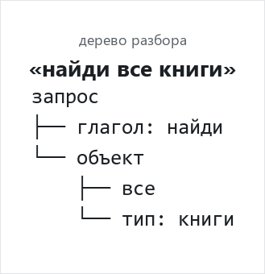
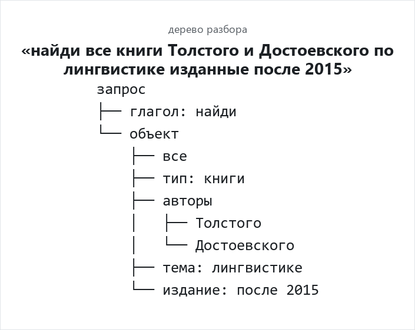

# Синтаксический анализатор запросов к библиотеке

Разборщик фраз ограниченного языка запросов к библиотеке. По формальной грамматике строит дерево разбора. Если фраза грамматике не соответствует, сообщает место ошибки.

Нужен Python 3.12.

## Запуск

```
py -3.12 -m venv .venv
.\.venv\Scripts\Activate.ps1
python main.py
python main.py "найди все книги"
```

Без аргумента печатаются короткий запрос, составной запрос и три неверных. Своя фраза передаётся аргументом.

## Грамматика

```
запрос   = глагол объект
глагол   = найди | покажи | выведи
объект   = [все] тип фильтр*
тип      = книги | статьи | журналы
фильтр   = год | авторы | тема | издание
год      = ЧИСЛО года
авторы   = имя (и имя)*
тема     = по ТЕМА
издание  = изданные после ЧИСЛО
имя      = Толстого | Достоевского
ТЕМА     = программированию | лингвистике
```

Регистр не важен, слова делятся пробелами, число — любой год. Имена и темы заданы списками в `grammar.py`.

## Результаты

`python main.py` печатает примеры ниже.

### Короткий запрос

«найди все книги». Корень — «запрос». У него два ребёнка: лист «глагол» и узел «объект». У объекта два листа: «все» и «тип». Фильтров нет.

```
запрос
├── глагол: найди
└── объект
    ├── все
    └── тип: книги
```



### Составной запрос

«найди все книги Толстого и Достоевского по лингвистике изданные после 2015». Корень снова «запрос»: лист «глагол» и узел «объект». У объекта листья «все» и «тип», дальше три фильтра. «Толстого и Достоевского» — узел «авторы», внутри него листья с именами. Союз «и» в дерево не входит. «по лингвистике» даёт лист «тема». «изданные после 2015» даёт лист «издание».

```
запрос
├── глагол: найди
└── объект
    ├── все
    ├── тип: книги
    ├── авторы
    │   ├── Толстого
    │   └── Достоевского
    ├── тема: лингвистике
    └── издание: после 2015
```



### Нет глагола

«книги Толстого». Первое слово — тип документа, а запрос обязан начинаться с глагола. Дерево не строится.

```
Ошибка на позиции 1: ожидалось глагол (найди, покажи или выведи), получено «книги»
```


### Нет типа

«найди». Глагол есть, дальше объект требует тип документа, а фраза кончилась. Дерево не строится.

```
Ошибка на позиции 2: ожидалось тип документа (книги, статьи или журналы), а слова кончились
```


### Неверный фильтр

«найди книги после 2015». Слово «после» стоит на позиции 3. Фильтр издания начинается со слова «изданные», поэтому одно «после» анализатор не принимает. Дерево не строится.

```
Ошибка на позиции 3: ожидалось фильтр (год, имя автора, «по» или «изданные»), получено «после»
```


## Состав

- `grammar.py` — допустимые слова и их роли
- `parser.py` — разбор фразы и печать дерева
- `main.py` — примеры
